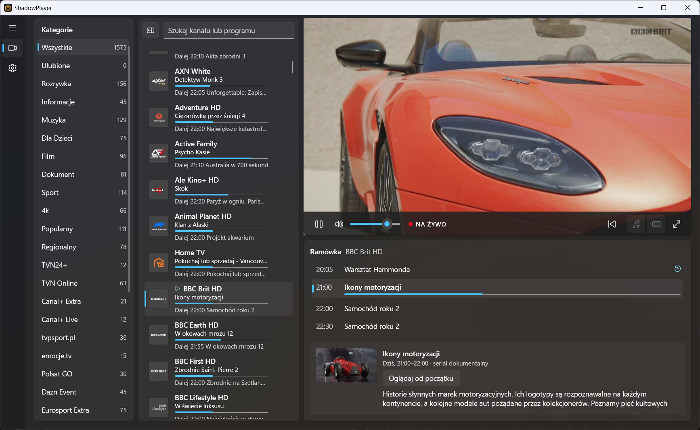

# ShadowPlayer

A simple, fast TV player for Windows 10 and 11. Add your M3U channel list, and ShadowPlayer shows your channels by category, together with a TV guide and the option to watch programmes from the start.

## Features

- **Your channel list**: add an M3U list from a web address or from a file on your disk. You can add several lists.
- **Categories**: channels grouped by category, with the number of channels in each. Pin the ones you use most to the top and hide the ones you don't need.
- **Favourites**: hover over a channel and click the star to keep it in your Favourites.
- **Search**: find a channel or a programme by typing part of its name.
- **TV guide (EPG)**: see what is on now and next on every channel, with a progress bar for the current programme. An EPG source can be added from a web address or a file, and many lists add it automatically.
- **Archive and watch from the start**: on channels that support it, go back to a programme that has already started or finished and watch it from the beginning, then return to live with one click.
- **Automatic refresh**: lists and the TV guide update by themselves at the interval you choose (from 1 hour to 7 days), or on demand.
- **Smooth playback**: if the stream drops, the player reconnects by itself. You can choose the audio track and subtitles, and switch on hardware decoding.
- **Full screen and keyboard control**: watch in full screen and control everything from the keyboard (see below).
- **Picks up where you left off**: optionally plays the last channel when the app starts, or starts straight in full screen.
- **Light and dark theme**, or follow the Windows setting.
- **Seven languages**: Polish, English, German, Spanish, French, Italian and Ukrainian.
- **Automatic updates**: the app tells you when a new version is out and installs it for you. Every download is checked before it runs.

## Installation

1. Download the latest `ShadowPlayer-Setup-<version>.exe` from the [Releases](https://github.com/w00li/ShadowPlayer/releases/latest) page.
2. Run it and follow the steps. Administrator rights are needed. Nothing else needs to be installed.

To update, accept the offer in the app or run a newer installer. Your lists, favourites and settings are kept.

## Getting started

1. Open **Settings** (the gear icon on the left) and choose **Add list**.
2. Paste the address of your M3U list, or choose a file from your disk, and give it a name.
3. Optionally add an **EPG source** to see the TV guide. If your list already points to one, it is added for you.
4. Go back to the channel list and pick a channel.

ShadowPlayer does not come with any channels. You need your own M3U list, for example from your TV provider.

## Keyboard shortcuts

| Key | Action |
|-----|--------|
| Space | Play / pause |
| F | Full screen on / off |
| Esc | Leave full screen |
| M | Mute / unmute |
| ↑ / ↓ | Previous / next channel |
| ← / → | Skip back / forward (skip back also works on live TV, if the channel has an archive) |
| Home | Watch the current programme from the start |

## Your data

Everything stays on your computer, in `%LocalAppData%\M3uPlayer`. To start over, use **Settings → Data → Clear all data**. Uninstalling the app keeps your data, so you can delete that folder by hand if you no longer need it.

## License

ShadowPlayer is free software under the [GNU GPL v3](LICENSE).

Building from source and other technical details: [docs/DEVELOPMENT.md](docs/DEVELOPMENT.md).
